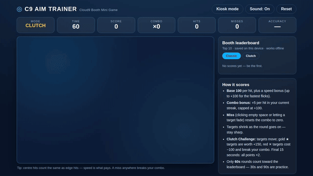
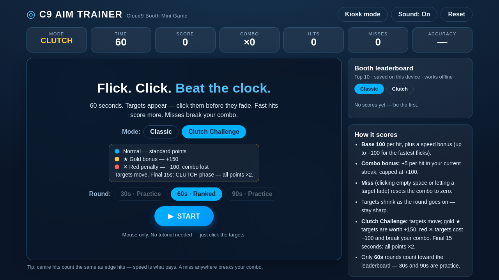
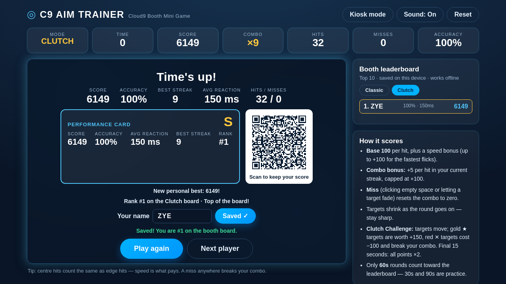

# C9 Aim Trainer

A fast, mouse-only flick-shot trainer built for the **Cloud9 x JetBrains: Sky's The Limit Hackathon 2026** — Category 3 (Event Mini Game).

**Live loop:** START → targets appear one at a time → click them before they fade → 60-second round ends → score screen with accuracy, best streak and average reaction time → save to the offline booth leaderboard → clean reset for the next player.







## Why this fits Category 3

A Cloud9 booth needs a game a stranger can pick up in seconds, play in under 3 minutes, and walk away from without leaving a mess for the next fan. C9 Aim Trainer is exactly that: mouse-only controls, a giant START button, no tutorial, an instant score screen, and a local leaderboard that works with no Wi-Fi (the judges call offline storage "a massive plus"). See [METHODOLOGY.md](METHODOLOGY.md) for the full reasoning.

## How to run

No build step, no dependencies, no network needed.

```bash
# Option 1: just open it
open index.html          # or double-click it in your file manager

# Option 2: static server (recommended for the demo video)
python3 -m http.server 8000
# then visit http://localhost:8000
```

Works in any modern desktop browser. Mouse required.

## How to play

- Pick a mode: **Classic** (the shipped flick-shot loop) or **Clutch Challenge** (moving targets, bonus/penalty targets, a 2× clutch phase in the final 15 seconds).
- Pick a round length: **30s · Practice / 60s · Ranked / 90s · Practice** (default 60s). Only 60-second rounds count toward the leaderboard — 30s and 90s are practice.
- Click **START**. Targets appear at random positions — click them before they fade.
- **Scoring:** 100 base per hit + up to 100 speed bonus (faster flick = more points) + combo bonus (+5 per hit in your streak, capped at +100).
- **Miss** — clicking empty space, or letting a target fade — resets your combo to zero.
- **Clutch Challenge:** targets drift and bounce. Gold ★ targets are worth +150; red ✕ targets cost −100 and break your combo. In the final 15 seconds every point is doubled (penalty stays −100). Clutch has its own leaderboard — switch tabs above the board.
- When time runs out you get your score, accuracy, best streak and average reaction time, plus a **Performance Card** (rating S/A/B/C), your personal best and your rank. Enter your name and **Save score** to join the top-10 booth leaderboard (stored in `localStorage` on that device, works offline). After a successful save a **QR code** appears — scan it with your phone to keep your score.
- **Play again** starts a new round immediately; **Next player** returns to the clean start screen. In booth mode the end screen also resets itself after 60 seconds of no activity — every touch restarts that countdown, so a walk-away never blocks the next player.
- **Kiosk mode** (header button, or open with `?kiosk=1`): fullscreen, an attract screen after 90s idle on the start screen, and a hidden admin panel (long-press the ◎ brand mark for 3s). Clearing a board needs a 3-second hold **and** typing `CLEAR` — a stray tap can never wipe it.

## JetBrains tooling used

This is a **WebStorm project**. The `.idea/` folder is committed as evidence, as the hackathon rules encourage:

- **WebStorm** — the project IDE: `index.html`, `style.css` and `game.js` live in a WebStorm web project (see `.idea/misc.xml`, `.idea/modules.xml`, `c9-aim-trainer.iml`). WebStorm's built-in inspections were used for the HTML/CSS/JS, and its live-edit/static-server workflow was used to playtest the game loop.
- **JetBrains AI / Junie-style assistance** — the code was authored with AI assistance inside this WebStorm project layout; see [AI_SHOWCASE.md](AI_SHOWCASE.md) for the honest, detailed account (including what was *not* done: no GUI WebStorm session is claimed where none happened — the project structure was created by hand to match a real WebStorm project).
- **JetBrains Air / Junie** — listed as the intended next step once the trial codes from registration arrive: the All Products Pack code unlocks WebStorm + AI Ultimate for the polish pass.

Honest note: no JetBrains IDE was installed on the build machine at authoring time, so the `.idea/` project files were written by hand to the WebStorm format and verified to parse as valid XML. The code itself is plain, dependency-free web code — it does not depend on any IDE to run.

**v1.1.1 (24 Nov 2026) — agent-built, WebStorm pass to follow.** The upgrade round (Clutch Challenge Mode, Kiosk Mode, 60s-only ranked leaderboard, Performance Card, score-to-phone QR) was executed by the AI agent (Muse) per the written spec, with a 51-check automated headless suite green and 0 console errors — see [AI_SHOWCASE.md](AI_SHOWCASE.md) and [QA_CHECKLIST.md](QA_CHECKLIST.md). The JetBrains trial codes (All Products Pack + AI Ultimate) arrived 24 Nov 2026; a real WebStorm/Junie pass follows later as a separate, dated addendum. Nothing in this round claims a WebStorm GUI session that did not happen.

## Files

| File | What it is |
|---|---|
| `index.html` | Page structure: HUD, arena, start/end overlays, leaderboard panel, admin panel |
| `style.css` | Cloud9 navy / sky-blue theme, target + overlay animations |
| `game.js` | Game logic: Classic + Clutch modes, scoring, combo, timer, leaderboards, kiosk, QR, sound |
| `vendor/qrcodegen.js` | Vendored Nayuki QR encoder (MIT, ~46 KB) — the QR code is generated client-side, no network |
| `.idea/`, `c9-aim-trainer.iml` | WebStorm project configuration |
| `METHODOLOGY.md` | Approach + how it solves the booth problem |
| `AI_SHOWCASE.md` | AI/JetBrains workflow case study (bonus prize) |
| `QA_CHECKLIST.md` | Playtest checklist — every row ticked by a real headless run |
| `VIDEO-SHOTLIST.md` | Shot list for the <3 min demo video |
| `docs/` | `demo.gif` (gameplay loop), `start.png`, `end.png` (screenshots used above) |
| `LICENSE` | MIT |

## Originality

All names, art and styling are original (Cloud9-blue theme, no logos). No Riot Games / VALORANT / League of Legends assets, names, artwork or logos are used anywhere in the game.
